# Grafo das variáveis matemáticas da extensão (`automation.js`)

> **Âmbito.** Só análise. Nenhum ficheiro de `extension/` foi alterado. Tudo o que aqui está tem
> `file:linha`; o que não pôde ser provado está marcado **NÃO VERIFICADO** e o que não tem medição
> está marcado **sem medição**.
>
> **Fonte das regras do jogo:** `docs/game-src/motor.js` (4114 linhas). Os comentários do
> `automation.js` **não** são tratados como fonte — vários citam linhas do `motor.js` que já não
> existem (Anexo A).
>
> **Data:** 2026-10-23. Números do `automation.js` contados nesse dia (o ficheiro tem 13 975 linhas).

---

## 0. Como ler isto

Três leituras, em ordem de utilidade:

1. **§3 (divergências)** — onde duas contas paralelas discordam. É a lista accionável.
2. **§4 (contradições)** — o que a GUI mostra contra o que a decisão usa. É o que o dono vê.
3. **§2 (grafo)** — o mapa. Serve para responder "se eu mexer aqui, o que cai?".

A regra que organiza o documento: **uma função de AGREGAÇÃO que chama uma MEDIÇÃO AO VIVO, e uma
medição ao vivo que chama a agregação de volta, é um ciclo** — o ciclo real que travou o jogo está
documentado em `AGENTS.md`, REGRA Nº 15, e o nó onde ele fecha (`agregar`) está marcado com `⟲` no
grafo (§2).

---

## 1. Inventário de variáveis

Colunas: **variável** · onde é **produzida** na extensão · onde está a **regra** no `motor.js` · quem
**consome** · quantos produtores independentes tem.

### 1.1 Combate — dano recebido e sobrevivência

| variável | produzida em | regra no motor | consumidores | produtores |
|---|---|---|---|---|
| `mobLevel` | `automation.js:1879` (teoria, `P-0,5`), `automation.js:9770` (`nivelAlvo`) | `motor.js:1217` `max(n0,min(n1,P-2+rand(0..3)))` | `statsMonstro`, `estimarRegiao`, `riscoMob` | **2** (dois sítios, mesma conta) |
| `nivelChefe` | `automation.js:1731` (`nivelChefeDe`), `automation.js:9768` (`nivelAlvo`) | `motor.js:1219` `max(n0+2,min(n1+2,P+4))` | `agregar:3589`, `estimarLuta:12620` | **2** (duplicados) |
| `mobsPerWave` | `automation.js:9783` (`mediaWaveDe`) | `motor.js:1222` `qtd = 2+floor(r()*3)` | `estimarRegiao:1899`, `ritmoMobs:1251`, `valorDoPonto:3251` | 1 |
| `respawnS` | `automation.js:1903` (`clear+local` = 2,7 s) | `motor.js:1739` (1,5 s por wave) + `motor.js:3321` (1,2 s na viagem) | `estimarRegiao:1904` | 1 (mas soma duas regras diferentes) |
| `mobHp` | `automation.js:1886` / `9780` via `curva()` (`automation.js:1708`) | `motor.js:1168` + `CURVA.hp` `motor.js:301` | `estimarRegiao`, `meuDps`, `estimarSet` | 1 |
| `fM` (dano do monstro) | `automation.js:3478` | `motor.js:1287` + `1289` | `avaliar:3493` | **2 tabelas de fallback** (ver D07) |
| `fJ` (dano do jogador) | `automation.js:3479`, `automation.js:12648` | `motor.js:1287` + `1325` | `avaliar`, `estimarLuta:12649` | **2** (fallbacks diferentes) |
| `mit` (mitigação) | `automation.js:3484`, `7445`, `11941` | `motor.js:1268` `100/(100+arm)` | `avaliar`, `estimarSet`, `scoreSet` | **3** |
| `RM_MONSTRO` | `armMagicaEfetiva` (usada em `12641`, `7445`, `11941`) | `motor.js:1282` = 0,6; aplicado em `1305` | `estimarLuta`, `estimarSet`, `scoreSet` | 1 (constante lida) |
| `dpsTomado` | `automation.js:3493` | `motor.js:1289` × `1268` × papel `1315` | `avaliar:3525`, `estimarLuta:12653` | 1 |
| `danoGolpe` | `automation.js:3494` | idem + `motor.js:1316` (crítico do monstro) | `melhorMix:3527`, GUI do chefe | 1 |
| `piorMec` | `automation.js:3496-3502` | rodízio `motor.js:3355`, multiplicadores `3377-3384` | `mortal:3510` | 1 |
| `curaRv` | `automation.js:3516` | `motor.js:1332-1336` (**só** `fonte === 'ataque'`) | `curaTotal:3524` | **2** (ver D10) |
| `curaGiro` | `automation.js:2666` (`curaGiroS`) via `automation.js:3121` | `motor.js:796` `curaGiro = serie(0.08, 0.01)` | `avaliar`, `agregar`, `decidirPocao` | **2** (teoria + medida do canvas) |
| `curaRegen` | `automation.js:3520` ← `player().regen` (`2493`) | `motor.js:1464` | `avaliar:3524` | 1 |
| `curaSkill` / `curaAtaque` | `automation.js:2627` (`sustentoDoKit`) | `motor.js:790` (`curaSede`), `718` (`curaSangue`) | `avaliar:3511/3523` | 1 (**detalhe interno NÃO VERIFICADO**) |
| `curaPocao` | `automation.js:3592` (medida), `3594` (`cp*0,6`), `1970` (`*0,6`) | `motor.js:288-294` + `1407-1416` + `42` | `avaliar:3524`, `estimarLuta:12654` | **3 modelos** (D08) |
| `nPocoes` | `automation.js:3487` `floor(intervalo/EXAUSTAO)` | `motor.js:42` `EXAUSTAO = 1` | `melhorMix:3527` | 1 |
| `tMorrer` | `automation.js:3528`, `12657`, `12687` | — (modelo da extensão) | `morre`, `estimarLuta.ganha`, `sobrevivenciaSet` | **3** (D01) |
| `morre` / `sobrevive` | `automation.js:3529`, `2086`, `3964`, `12661`, `12697`, `3611`, `13073`, `13094` | — | GUI, `regiaoIdeal`, `checarChefeFatal`, `montarBuildDePorScore` | **8** (D01) |
| `_dpsCache` | `automation.js:3548`, `13466-13473` (TTL 60 s) | — | `_agregarCorpo:3600` | 1 (com validade temporal) |

### 1.2 Economia — xp e ouro

| variável | produzida em | regra no motor | consumidores | produtores |
|---|---|---|---|---|
| `xpK` (xp por abate) | `automation.js:1884` | `motor.js:1169` + `1880` (`VIP.xp` 1,2; `fatorXp`) | `xpMin:2114` | 1 |
| `goldK` (ouro por abate) | `automation.js:1885` | `motor.js:1169` (`0,5+rand*0,5`) + `1873` (`ouroMult`, `fatorSaque`) | `goldMin:2114` | 1 |
| `fatorXp` / `fatorSaque` | `automation.js:1880` | `motor.js:455-458` | `xpK`, `goldK`, `runasKill` | 1 |
| `multMedio` (furioso/noturno) | `automation.js:1848-1853` | `motor.js:1207` (`tornarFurioso`), `NOTURNO` | `xpK`, `goldK` (`1901`) | 1 |
| `killsMin` (teórico) | `automation.js:1904-1911` (`min(spawn, dps)`) | `motor.js:1739` + `1222` | `xpMin`, `goldMin`, `scoreRegiao` | 1 |
| `killsMin` (medido) | `automation.js:3602` (`r.k/d`) | — | `agregar`, `meuDps`, `recomendar` | 1 |
| `xpMin` (tecto) | `automation.js:2114` | — | `rankRegioes` (`xpTeto`), GUI | **2** (tecto vs real) |
| `xpMinReal` | `automation.js:2099-2107` | — | `rankRegioes:13089`, `scoreRegiao:12960` | 1 |
| `goldMin` (tecto) | `automation.js:2114` | — | `rankRegioes`, `scoreRegiao` | **2** (nome igual, contas diferentes — D04) |
| `goldMinReal` | `automation.js:2099-2107` | — | `rankRegioes:13089` | 1 |
| `goldLiqMin` | `automation.js:2114` `max(0, goldReal - goldPotionMin)` | — | `scoreRegiao:12961` (ramo teórico) | 1 |
| `goldMin` (medido) | `automation.js:3602` (`r.g/d`) | — | `recomendar:3613`, `agregar`, GUI `2628` | 1 |
| `goldPotionMin` | `automation.js:2114` (teórico), `3602` (medido) | `motor.js:288-294` (preços) | `recomendar`, `scoreRegiao` | **2** |
| `runasKill` / `runasH` | `automation.js:1915-1916` | `GEMAS` via `META.gemas` | `rankRegioes.runasH` | 1 |
| `score` (região) | `automation.js:12955-12966` | taxa `curva().xp/ouro` (`12952`) | `regiaoRecomendada:13024`, `rankRegioes:13095` | **1 função, 2 definições de ouro** (D04) |

### 1.3 Build — itens, CDR, DPS de decisão

| variável | produzida em | regra no motor | consumidores | produtores |
|---|---|---|---|---|
| `meuDps` | `automation.js:1856-1867` (`mobHp*killsMin/60`) | — (medido) | `estimarRegiao:1905`, `estimarLuta:12639`, `decidirPocao` | 1 |
| `dpsPorHabilidade` | `automation.js:3061-3126` | kit `KAT`, `motor.js:1789` (Voracidade), `2283` (adagas) | `curaGiroS`, GUI de skills | 1 |
| `estimarSet.dps` | `automation.js:7389-7448` | `motor.js:1305` (mitigação) | `sobrevivenciaSet:12690`, `montarBuildDePorScore:10613` | 1 |
| `scoreSet` | `automation.js:11932-12006` | `motor.js:1199/1226` (crítico), `580` (pen armadura) | beam da build (`10562`), desempate do `alvoEquip` (`9341`) | 1 |
| `cdr` (painel) | `automation.js:2485` ← HUD | `motor.js:578` `min(0,4, foco+itens)` | `player().cdr` | 1 |
| `cdr` (itens) | `automation.js:7232` (`c*qm` por item), tecto `7291` | `motor.js:282` (escala) + `578` (tecto) | `estimarSet:7433`, `scoreSet:11960` | **3** (D06) |
| `cdr` (efeitos) | `automation.js:3049-3050` (prefere o painel) | idem | `dpsPorHabilidade:3065` | — |
| `cdVoraz` | `automation.js:2710-2717` | `motor.js:1789` | `dpsPorHabilidade:3111` | 1 (**ausente** em `estimarSet`/`scoreSet`) |
| `taxaDagas` | `automation.js:2723` | `motor.js:777` (`pegaCada`), `2283` | `cdComAdagas` | 1 |
| `pesosItem` | `automation.js:8312-8318` | — (heurística declarada) | `valorDeFase`, `alvoEquip`, `montarBuildDePesos` | 1 |
| `rvPeso` | `automation.js:8311` (`DPS_REF_RV=300`, `T_REF_RV=10`, `AD_REF_PESO=1,4`) | `motor.js:1332` (só auto) | `pesosItem` | 1 (estático — D10) |
| `build ideal` | `automation.js:10427` → `10483` (beam + luta) | — | `planoBuildFase:10804`, GUI, `componentesDaBuild` | **2** (score vs pesos, D05) |
| `preço de anúncio` | `automation.js:7850`, `7893`, `7993` | `motor.js:284` (`valorVenda`) é outra conta | `planejarMercado` | **3** (D17) |

---

## 2. Grafo

Laranja (**multi**) = variável com **mais de um produtor independente** (duas contas que podem
discordar). Azul (**single**) = um produtor só. Verde (**motor**) = regra lida do jogo.

```mermaid
graph TD
  classDef multi fill:#ffcc80,stroke:#e65100,stroke-width:2px,color:#000
  classDef single fill:#bbdefb,stroke:#1565c0,color:#000
  classDef motor fill:#c8e6c9,stroke:#2e7d32,color:#000

  subgraph MOTOR["motor.js — regras aplicadas"]
    M_CURVA["CURVA hp/ad/armadura/xp/ouro<br/>motor.js:300-306"]:::motor
    M_SPAWN["gerarGrupo: nivel P-2..P+1, qtd 2..4<br/>motor.js:1214-1228"]:::motor
    M_RESP["respawn 1,5 s wave · 1,2 s viagem<br/>motor.js:1739 · 3321"]:::motor
    M_ND["NIVEL_DIF 0,35 / 5 / 0,12<br/>motor.js:1287-1290"]:::motor
    M_MIT["mitigar 100/100+arm · RM_MONSTRO 0,6<br/>motor.js:1268 · 1282 · 1305"]:::motor
    M_RV["roubo de vida SÓ no auto<br/>motor.js:1332-1336"]:::motor
    M_POT["POCOES 300/900/2200 · EXAUSTAO 1<br/>motor.js:288-294 · 42"]:::motor
    M_KIT["kit: curaGiro · curaSede · defesaBonus<br/>motor.js:796 · 790 · 721"]:::motor
    M_ITEM["infoItem escala 11 campos, sem pen<br/>motor.js:279-283"]:::motor
  end

  subgraph SOBREV["SOBREVIVÊNCIA"]
    S_MOBLVL["mobLevel<br/>1879 · 9770"]:::multi
    S_CHEFLVL["nivelChefe<br/>1731 · 9768"]:::multi
    S_DPSMED["meuDps — medido<br/>1856-1867"]:::single
    S_DPSSK["dpsPorHabilidade — teórico<br/>3061-3126"]:::single
    S_AVALIAR["avaliar<br/>3473-3529"]:::single
    S_CURA["curaTotal<br/>3516-3524"]:::multi
    S_TMORRER["tMorrer<br/>3528 · 12657 · 12687"]:::multi
    S_MORTE["morte / sobrevive<br/>8 definições — §3 D01"]:::multi
    S_ESTLUTA["estimarLuta.ganha<br/>12616-12673"]:::single
    S_SOBREVSET["sobrevivenciaSet.morre<br/>12675-12702"]:::single
  end

  subgraph ECON["ECONOMIA xp/ouro"]
    E_KILLS["killsMin<br/>teórico 1904 · medido 3602"]:::multi
    E_XP["xpMin / xpMinReal<br/>2114 · 2099"]:::multi
    E_GOLD["goldMin tecto · goldMinReal · goldLiqMin<br/>2114 · 2099 · 2114"]:::multi
    E_GOLDMED["goldMin medido<br/>3602"]:::single
    E_SCORE["scoreRegiao<br/>12955-12966"]:::multi
    E_AGREGAR["agregar ⟲<br/>3549-3606"]:::single
    E_RECOM["recomendar<br/>3609-3631"]:::single
  end

  subgraph BUILD["BUILD"]
    B_STATSSET["statsSet: cdr/pen/rv/crit<br/>7188-7291"]:::single
    B_ESTIMARSET["estimarSet: dps com mitigação<br/>7389-7448"]:::single
    B_SCORESET["scoreSet: score de stats<br/>11932-12006"]:::single
    B_CDR["cdr<br/>painel 2485 · itens 7232 · efeitos 3049"]:::multi
    B_PESOS["pesosItem / valorDeFase<br/>8312 · 9010"]:::single
    B_ALVO["alvoEquip<br/>9240-9356"]:::single
    B_BEAM["montarBuildDePorScore<br/>10483-10639"]:::single
    B_IDEAL["build ideal<br/>10427"]:::multi
  end

  subgraph MERCADO["MERCADO"]
    K_ANUNC["precoDeAnuncio<br/>7850-7887"]:::single
    K_REF["referenciaPrecoMercado<br/>7893-..."]:::single
    K_PLAN["planejarMercado<br/>7962-8001"]:::single
    K_EXC["precoSemComparavel 1,5M · Gume 10M<br/>cfg 193 · 198"]:::multi
  end

  M_SPAWN --> S_MOBLVL
  M_CURVA --> S_MOBLVL
  M_ND --> S_AVALIAR
  M_MIT --> S_AVALIAR
  M_RV --> S_CURA
  M_KIT --> S_CURA
  M_POT --> S_CURA
  S_CURA --> S_AVALIAR
  S_AVALIAR --> S_TMORRER
  S_TMORRER --> S_MORTE
  S_DPSMED --> S_AVALIAR
  S_DPSMED --> S_ESTLUTA
  S_AVALIAR --> S_SOBREVSET
  S_ESTLUTA --> S_SOBREVSET
  S_SOBREVSET --> B_BEAM

  M_CURVA --> E_KILLS
  M_RESP --> E_KILLS
  E_KILLS --> E_XP
  E_KILLS --> E_GOLD
  E_XP --> E_SCORE
  E_GOLD --> E_SCORE
  E_GOLDMED --> E_SCORE
  E_GOLDMED --> E_AGREGAR
  E_AGREGAR --> E_KILLS
  E_AGREGAR --> E_SCORE
  E_SCORE --> E_RECOM
  E_AGREGAR --> E_RECOM
  E_RECOM --> S_MORTE

  M_ITEM --> B_STATSSET
  B_STATSSET --> B_ESTIMARSET
  B_STATSSET --> B_SCORESET
  B_CDR --> B_ESTIMARSET
  B_CDR --> B_SCORESET
  B_ESTIMARSET --> S_DPSMED
  B_SCORESET --> B_BEAM
  B_PESOS --> B_ALVO
  B_SCORESET --> B_ALVO
  B_BEAM --> B_IDEAL
  B_PESOS --> B_IDEAL
  E_SCORE --> B_IDEAL
  S_SOBREVSET --> B_IDEAL

  K_EXC --> K_ANUNC
  K_EXC --> K_REF
  K_ANUNC --> K_PLAN
  K_REF --> K_PLAN
  B_IDEAL --> K_PLAN
```



### 2.1 Variáveis com mais de um produtor (as que podem discordar)

| variável | produtor A | produtor B | produtor C |
|---|---|---|---|
| `morte` / `sobrevive` | `estimarRegiao` `2086` | `avaliar` `3529` | `checarChefeFatal` `3964`, `sobrevivenciaSet` `12697`, `regiaoSegura` `13073`, `rankRegioes` `13094`, `recomendar` `3611` |
| `tMorrer` | `avaliar` `3528` (com cura) | `estimarLuta` `12657` (líquido − poção) | `sobrevivenciaSet` `12687` (sem cura, sem poção) |
| `cura` | `avaliar` `3524` | `_agregarCorpo` `3592-3601` | `estimarLuta` `12628-12654` |
| `cdr` | painel `2485` | `statsSet` `7232` | `efeitosEquipados` `3049` |
| `dps` | `meuDps` `1856` | `dpsPorHabilidade` `3061` | `estimarSet` `7389`, `scoreSet` `11932` |
| `goldMin` | tecto `2114` | real `2099` | medido `3602` |
| `xpMin` | tecto `2114` | real `2099` | medido (via `agregar`) |
| `score` (região) | medido **bruto** `12961` | teórico **líquido** `12961` | — |
| `killsMin` | spawn `1904` | dps `1909` | medido `3602` |
| `build ideal` | beam+`scoreSet` `10562` | `sobrevivenciaSet`+`estimarLuta` `10608` | `pesosItem` `8312` |
| `preço` | `precoDeAnuncio` `7850` | `referenciaPrecoMercado` `7893` | regra de cancelamento `7993` |

---

## 3. Divergências (as duas partes, com `file:linha`)

### D01 — A sobrevivência tem oito definições

| # | onde | definição | consequência |
|---|---|---|---|
| 1 | `automation.js:2086` | `morte = mobsMatam \|\| chefeMatam` | mobs **ou** chefe |
| 2 | `automation.js:3529` | `morre = liquido > 0 \|\| !mix \|\| mortal` | só a luta de chefe (`agregar` só cria `risco` se `r.boss`, `3601`) |
| 3 | `automation.js:3964` | `morre = mobsMatam \|\| (chefeMata && bosAgora)` | depende do momento (chefe em cena) |
| 4 | `automation.js:3611` | `filter(r => r.risco && !r.risco.morre)` | só regiões **com chefe** |
| 5 | `automation.js:12995` | `x.e.morte === false` | fail-closed, mobs **ou** chefe |
| 6 | `automation.js:13073` | `morte === false \|\| mobsSeguros === true` | aceita região onde o chefe mata |
| 7 | `automation.js:13094` | `sobrevive = e.morte === false` | fail-closed |
| 8 | `automation.js:12697` | `morre = tMorrer < tKill` | sem cura, sem poção |

**Leitura:** (1) e (7) são a mesma expressão; (6) é deliberadamente mais largo (regra do dono,
`13070-13073`); (2) e (3) medem coisas diferentes — (2) é o **chefe**, (3) é **mobs + chefe em cena**;
(8) é o mais pessimista de todos. **Nenhum par é igual.** E os consumidores misturam-nos no mesmo
ciclo: a GUI lê (4) `recomendar` e (7) `rankRegioes`; a escolha de região lê (5); a validação da
viagem/memória lê (6); a fuga lê (3); a build lê (8).

### D02 — `recomendar` devolve `sobrevive: true` sempre

`automation.js:3615` e `automation.js:3628` escrevem `sobrevive: true` **à letra**, nos dois ramos.
Os consumidores tratam esse campo como veredicto:

- `gui.js:2030` mostra "⚠ Nessa região o chefe mata você" só se `rec.sobrevive === false` → **nunca**.
- `gui.js:2648` mostra "só mobs: o chefe mata" no mesmo teste → **nunca**.
- `gui.js:3687-3688` escreve "(região onde você sobrevive ao chefe)" sempre que `rec.sobrevive === true`
  → **sempre**, inclusive numa região onde `estimarLuta.ganha === false`.

Nenhum destes três sítios pode ser exercitado hoje. **A decisão já filtrou** (o ramo 1 só aceita
`!risco.morre`, `3611`), mas a mensagem ao dono ficou congelada na resposta optimista.

### D03 — `recomendar` só vê regiões com chefe

`risco` só existe quando `r.boss && nivelChefe` (`automation.js:3601`). O filtro do ramo medido exige
`r.risco` (`3611`). Logo uma região **sem chefe** nunca entra no ramo medido e cai-se no ramo teórico
(`3617`). O campo `sobrevive: true` de D02 esconde isto.

### D04 — `scoreRegiao`: ouro bruto vs ouro líquido

```
automation.js:12961
const ouro = (medido && medido.goldMin != null) ? medido.goldMin      // BRUTO (3602 = r.g/d)
                                            : (e.goldLiqMin != null ? e.goldLiqMin : (e.goldMin || 0));
```

- Ramo **medido**: `medido.goldMin` = `r.g/d` (`3602`) — ouro ganho, **sem** descontar poções.
- Ramo **teórico**: `e.goldLiqMin` = `max(0, goldReal - goldPotionMin)` (`2114`) — **líquido**.

Quem chama:

| chamador | `medido` | definição de ouro |
|---|---|---|
| `regiaoRecomendada` (`13021-13024`) | a linha medida, quando `n >= 3` | **bruta** |
| `rankRegioes` (`13095`) | `null` | **líquida** |

Ou seja: o `score` que ordena as regiões **medidas** usa ouro **bruto**; o que ordena as **teóricas**
usa ouro **líquido**. E nenhuma das duas colunas de ouro que a GUI mostra (`gui.js:2644` =
`r.goldMin`, `gui.js:2665` = `x.goldMin`) é a grandeza que ordena a tabela teórica — essa é
`goldLiqMin`, que não tem coluna.

### D05 — Duas máquinas de build que discordam sobre quem decide

| caminho | o que decide | `file:linha` |
|---|---|---|
| GUI / plano de fase | beam **poda** por `scoreSet`, escolha final por `sobrevivenciaSet` + `estimarLuta` | `10483-10639`, `10804` |
| Equipar agora | `alvoEquip` decide por `valorDeFase`/`pesosItem`; `scoreSet` é **só desempate** | `9240`, `9337-9347` |
| Legado (`cfg.trocaItens`) | `melhorSet` sobre `scoreSet` | `12009` |

O próprio ficheiro mede a discordância: `scoreSet` preferia a build **sem** CDR (`2504` vs `2343`) e o
harness matava em **42,75 s** contra **38,95 s** (`automation.js:10578-10579`). A build ideal mostrada
não é, por construção, a build que o `alvoEquip` veste.

### D06 — Três fontes de CDR

| fonte | valor | `file:linha` |
|---|---|---|
| painel | foco + itens, tecto 0,4 | `2485`, `motor.js:578` |
| itens (`statsSet`) | `c*qm` por item, tecto `CAP_CDR` | `7232`, `7291` |
| `efeitosEquipados` | prefere o painel, cai nos itens | `3049-3050` |

`estimarSet` (`7433`) e `scoreSet` (`11960`) usam a fonte **itens**, que **não inclui o foco**. Um
campeão com 10 de Foco tem 4% de CDR (`3045-3047`) que as duas avaliações de build não vêem.

### D07 — Duas tabelas de `NIVEL_DIF` no mesmo ficheiro

| sítio | valores | igual ao motor? |
|---|---|---|
| `automation.js:2547` `NIVEL_DIF_FB` | 0,35 / 5 / 0,12 | **sim** (`motor.js:1287`) |
| `automation.js:3477` fallback de `avaliar` | **0,15 / 3 / 0,07** | **não** — são os valores de antes de 13/10/2026 (`motor.js:1287`, comentário) |
| `automation.js:12648` fallback de `estimarLuta` | `danoJogador 0,12`, `minDanoJogador 0,25` | sim (só o `fJ`) |

Consequência numérica (só quando `META.nivelDif` **não** chegou): chefe 8 níveis acima com a faixa
livre de 4 → `dif = 8`.

- `avaliar`: `fM = min(3, 1 + 0,15×8) = 2,2`
- motor: `fM = min(5, 1 + 0,35×8) = 3,8`

O monstro bate **+72,7%** mais do que `avaliar` calcula. Como `avaliar` é o motor de
`mobsMatam`/`chefeMatam` dentro de `estimarRegiao`, o veredicto de **todas** as regiões fica
optimista no caminho de fallback.

### D08 — A cura da poção é modelada de três maneiras

| modelo | fórmula | `file:linha` |
|---|---|---|
| `avaliar` | `pocao = curaPocaoMax() × 0,6` usado como **cura/s** | `1970` |
| `estimarLuta` | `curaPocaoS = max(1, curaPocaoMax()) / EXAUSTAO()` | `12654` |
| `checarPocoes` / `checarChefeFatal` | `temos = Σ quantidade × HEALVAL` vs `precisa = potTotal × curaPocaoMax()` | `13118-13119`, `3973-3974` |

Com a Suprema (`motor.js:291`, cura 2200, `EXAUSTAO = 1` em `motor.js:42`):

- `avaliar`: **1 320 hp/s** (60% da cura, tratada como ritmo contínuo)
- `estimarLuta`: **2 200 hp/s**

Factor **1,67×** entre os dois, no mesmo ficheiro, para a mesma poção. E o terceiro modelo compara
**quantidade de frascos** com `potTotal × cura`, o que é uma terceira unidade (frascos vs hp/s).

### D09 — `ouroPocao` usa 110 fixo

`automation.js:12670`, `12701` e `10610` multiplicam o número de poções por **110**. O preço real vem
de `pocaoInfo(k).preco` (`automation.js:1540`, `3269`), que lê `META.pocoes` (`motor.js:288-294`):
Suprema = **260**. Usar 110 é o preço da **Forte** (`motor.js:290`) — subestima o custo em até
**2,36×** (260/110) para quem usa Suprema. É um literal copiado onde já existe leitura (REGRA Nº 3).

### D10 — O roubo de vida entra em quatro contas diferentes

| sítio | conta | `file:linha` | conforme o motor? |
|---|---|---|---|
| motor | `cura = dano × rv` **só** se `fonte === 'ataque'` | `motor.js:1332-1336` | é a verdade |
| `avaliar` | `rv × dps × mit` — `dps` é o DPS total (AoE medido) | `automation.js:3516` | **não**: inclui habilidades |
| `estimarLuta` | chama `avaliar` **sem** o 5.º argumento | `automation.js:12637` | `curaRv = 0` — o comentário de `12651` diz que entrou |
| `scoreSet` | `(dano por auto) × (autos/s) × rv` | `automation.js:12003` | **sim** |
| `rvPeso` (dentro de `pesosItem`) | `w.vida × 300 × 10 × min(1, w.ad/1,4)` | `automation.js:8311` | aproximação estática declarada |

O mesmo `rv` de 0,15 com 300 de DPS vale **45 hp/s** em `avaliar` e **0** em `estimarLuta`. E a
`estimarLuta` é a que decide `ganha` (`12661`), que decide a fuga (`3966`, `3985`).

### D11 — `respawnS` soma uma regra por wave com uma regra de viagem

```
automation.js:1903
const respawnS = (rsp.clear + rsp.local);   // 1,5 + 1,2 = 2,7 s
```

No motor, `1,5` é o respawn **depois de limpar a wave** (`motor.js:1739`) e `1,2` é o respawn
**ao viajar** (`motor.js:3321`). Não acontecem os dois na mesma wave.

Efeito com `mobsPerWave = 3` (`9783-9786`, `META.grupoSpawn = {base:2, rand:3}`):

- com 2,7 s: `spawnKillsMin = 3/2,7×60 = 66,7` abates/min
- com 1,5 s: `spawnKillsMin = 3/1,5×60 = 120` abates/min

O tecto de spawn teórico fica **44% abaixo** do que o jogo permite. Como `killsMin = min(spawn, dps)`
(`1906-1911`), o erro só morde quando o tecto de spawn é o que limita.

### D12 — `sobrevivenciaSet` e `estimarLuta` medem a mesma luta com réguas diferentes

```
automation.js:12661  const ganha = tKill <= tMorrer;      // tMorrer com poção (netEfetivo, 12655)
automation.js:12697  const morre = tMorrer < tKill;       // tMorrer = vida / dpsChefe bruto (12687)
```

`sobrevivenciaSet` divide a vida por `luta.dpsChefe` **sem** descontar `curaTotal` nem `curaPocaoS`.
`estimarLuta` desconta as duas (`12653-12657`). A escolha final da build (`10605-10608`) mistura os
dois: usa `tKill` de `sobrevivenciaSet` e escala `lutaBase.tMorrerS` (de `estimarLuta`) pela razão de
vida. **A build é escolhida por uma conta híbrida que nenhuma das duas funções isoladas produz.**

### D13 — `statsMonstro` e o nível do chefe estão duplicados

| função | primeira definição | segunda definição | iguais? |
|---|---|---|---|
| `statsMonstro` | `1743` | `9776` | **sim**, corpo idêntico → a primeira é código morto |
| nível do chefe | `nivelChefeDe` `1731` | `nivelAlvo(local,'chefe')` `9768` | **sim**, mesma conta |

Não há divergência **hoje**; há risco de deriva: corrigir uma e não a outra.

### D14 — A GUI lê `chefeMatam`, o `rankRegioes` devolve `chefeFatal`

`automation.js:13089` devolve `chefeFatal: e.chefeMatam`. `gui.js:2658` testa
`x.chefeMatam === true`. O campo não existe na linha → a coluna de risco do chefe na tabela teórica
mostra **sempre** `- chefe`, nunca `💀 chefe`.

### D15 — `_dpsCache` de 60 s muda o veredicto do chefe

`automation.js:3600`: `dpsMed = (Date.now() - _dpsCache.at < 60000) ? _dpsCache.v : 0`.
Mais de 60 s sem `atualizarDpsCache` (`13466-13473`) → `dps = 0` → `curaRv = 0` em `avaliar` (`3516`)
→ `liquido` sobe (`3525`) → `risco.morre` pode virar `true` (`3529`) → `recomendar` muda de região
(`3611`). **Um campo com validade temporal é consumido por uma decisão sem validade temporal.**

### D16 — `recomendar` mistura duas fontes no mesmo campo

| ramo | `ouroLiquidoMin` | `goldMin` devolvido |
|---|---|---|
| medido (`3613-3615`) | `medido.goldMin − medido.goldPotionMin` | (não devolve) |
| teórico (`3623-3628`) | `m.goldMin − m.goldPotionMin`, com `m.goldMin = e.goldMinReal` (`13089`) | devolve |

O campo `ouroLiquidoMin` significa "medido" num ramo e "teórico real" no outro; `gui.js:2029` e
`gui.js:2648` imprimem-no como se fosse a mesma grandeza.

### D17 — Três implementações da política de preço

| regra | `precoDeAnuncio` `7850` | `referenciaPrecoMercado` `7893` | `planejarMercado` `7993` |
|---|---|---|---|
| 90% do menor do mesmo tier | `7874` | `7908` | usa `referenciaPrecoMercado` |
| tier superior como fallback | `7875` | `7907` | idem |
| excepção por base | `7878-7882` | fora | `7994` (`exc == null`) |
| 1,5M só tier A | `7885` | fora | `7995-7997` (re-deriva) |
| piso do Gume 10M | `7862` | `7902` | — |

As duas primeiras repetem a mesma escada com código próprio; a terceira **re-deriva** a condição do
1,5M em vez de perguntar. Um preço anunciado por `precoDeAnuncio` pode ser cancelado por
`planejarMercado` com uma regra escrita duas vezes.

### D18 — `estimarLuta` declara o roubo de vida e não o passa

```
automation.js:12637  const av = avaliar(boss, nivel, p, { skill: curaSkill, pocao: 0 });
automation.js:12651  // ROUBO DE VIDA (motor.js:1226-1228) + CURA DO GIRO (motor.js:2169) ja entraram no `curaTotal` do `avaliar`
```

A assinatura é `avaliar(monstro, nivel, player, cura, dps)` (`3473`) e `curaRv` depende de `dps`
(`3516`). Sem o 5.º argumento, `curaRv = 0`. O comentário afirma o contrário do que o código faz.

### D19 — O bónus de VIP está escrito à mão e assume VIP ligado

```
automation.js:1875  const vip = opts.vip != null ? opts.vip : true;      // VIP POR OMISSÃO
automation.js:1884  xpK += w * s.xp * fx * (vip ? 1.2 : 1) * bonus;      // 1,2 literal
automation.js:1914  const multR = (vip ? 1.2 : 1) * fs;                  // 1,2 literal outra vez
```

No motor, `VIP = { xp: 1.2, drop: 1.2, ... }` (`motor.js:152`) e o bónus só entra se
`ehVip(estado)` (`motor.js:1879-1880`). Aqui o factor está **copiado** (dois sítios) e a teoria
calcula **sempre como VIP** — um buff/nerf do VIP no jogo não chega a estes números (REGRA Nº 3), e
uma conta sem VIP vê xp/min teórico **+20%** acima do real. O ouro **não** leva VIP em nenhum dos
dois lados (`1885` vs `motor.js:1873`), o que está correcto.

---

## 4. Contradições numéricas concretas (GUI vs decisão)

| # | o que a GUI mostra | o que a decisão usa | número |
|---|---|---|---|
| C1 | "região onde você **sobrevive** ao chefe" (`gui.js:3688`) | `estimarLuta.ganha` (`12661`) pode ser `false` | `sobrevive` é literal `true` (`3615`, `3628`) em **toda** a região que `recomendar` devolve |
| C2 | "⚠ Nessa região o chefe mata você" (`gui.js:2030`) | nunca aparece | ramo **inalcançável** |
| C3 | coluna "risco · chefe" (`gui.js:2658`) | `rankRegioes` devolve `chefeFatal` (`13089`) | coluna mostra `- chefe` em **todas** as linhas |
| C4 | tabela medida `ouro/min` (`gui.js:2644`) = `r.goldMin` **bruto** | tabela teórica `ouro/min` (`gui.js:2665`) = `x.goldMin` = `goldMinReal`, também bruto | a coluna mostrada **não é** a que ordena a tabela teórica: o `score` usa `goldLiqMin` (líquido, `13095`). Cada tabela é ordenada por uma grandeza que o dono não vê |
| C5 | dano de monstro com fallback de `avaliar` (`3477`) | `NIVEL_DIF_FB` (`2547`) e motor (`1287`) | `fM` 2,2 vs 3,8 → **+72,7%** subestimado com `dif = 8` |
| C6 | cura/s de poção em `avaliar` (`1970`) | cura/s em `estimarLuta` (`12654`) | 1 320 vs 2 200 hp/s → **1,67×** |
| C7 | custo de poção em `ouroPocao` (`12670`) | preço da Suprema (`motor.js:291`) | 110 vs 260 → **2,36×** subestimado |
| C8 | roubo de vida em `avaliar` (`3516`) | `estimarLuta` (`12637`) | 45 hp/s vs **0** (rv 0,15, 300 dps) |
| C9 | abates/min teórico (`1904`) | respawn real do motor (`1739`) | 66,7 vs 120 abates/min → **44%** abaixo |
| C10 | margem de conforto do chefe `cfg.margemChefe = 0,70` (`automation.js:183`) | `chefeApertado` / `margemChefeMedida` (`1930-1932`) | o campo medido só existe se já houve luta — **sem medição** quando não houve |

**Nota sobre C10:** não consegui provar que `cfg.margemChefe` (`183`) e `margemChefeMedida`
(`2114`, campo `margemChefeMedida`) sejam consumidos pela mesma decisão. **NÃO VERIFICADO** — ficam
registados como campos separados, não como divergência provada.

---

## 5. Proposta de unificação (sem implementação)

Objectivo: **uma função por grandeza**, com o nome a dizer qual das definições é. Não se propõe
apagar nenhuma regra do dono — propõe-se que cada regra tenha **um** sítio.

### 5.1 SOBREVIVÊNCIA — um veredicto, dois eixos

```
veredicto(regiao) -> { mobs: 'seguro'|'mata'|'desconhecido',
                       chefe: 'seguro'|'mata'|'desconhecido',
                       fonte:  'medido'|'teoria',
                       evidencia: {n, mortesMob, mortesChefe} }
```

- `morte` (composto) passa a ser **derivado**: `mobs === 'mata' || chefe === 'mata'`, calculado num
  sítio só — hoje são oito (D01).
- Os **dois eixos** ficam separados porque o dono os separou (`automation.js:3942-3948`,
  `13070-13073`): juntá-los outra vez reabre o "fugia do Barão sem chefe no mapa".
- `regiaoSegura` passa a ler `mobs === 'seguro'` explicitamente, em vez de
  `morte === false || mobsSeguros === true` (`13073`) — mesma política, uma expressão.
- `desconhecido` continua a **bloquear** (fail-closed, `2080-2085`), nunca a passar.
- Fonte `medido` ganha sobre `teoria` **por região**, e o campo `fonte` sobe até à GUI — é o que falta
  para o dono saber se está a ver uma medida ou uma aposta.

**Uma `tMorrer`:** `tMorrer = vidaPool / max(ε, dpsTomado − curaTotal − curaPocaoS)`, calculada uma
vez, com `curaPocaoS` **da mesma unidade** de `dpsTomado` (hp/s, nunca "cura de um frasco"). Os três
consumidores (`3528`, `12657`, `12687`) passam a chamar a mesma função. Isto resolve D08 e D12 sem
tocar na regra "poções cobrem → termina o chefe" (`3967-3976`).

**`ganha` e `morre` complementares por construção:** uma função `duelo()` que devolve
`{ tKill, tMorrer, ganha, potTotal }`; `sobrevivenciaSet` passa a ser um **adaptador** que chama
`duelo()` com a vida do candidato. Hoje são duas contas (D12) e a build é escolhida por uma terceira
(`10605-10608`).

### 5.2 ECONOMIA — `xpMin`/`goldMin` com sufixo obrigatório

Renomear para que o nome não possa mentir:

| hoje | passa a ser |
|---|---|
| `xpMin` (`2114`) | `xpMinTeto` |
| `xpMinReal` (`2099`) | `xpMinRealista` |
| `goldMin` (`2114`) | `goldMinTeto` |
| `goldMinReal` (`2099`) | `goldMinRealista` |
| `goldLiqMin` (`2114`) | `goldMinLiquido` |
| `goldMin` medido (`3602`) | `goldMinMedidoBruto` + `goldMinMedidoLiquido` |

`scoreRegiao` (`12955`) recebe **um** par (`xp`, `ouro`) já com a definição escolhida pelo chamador e
nunca mistura bruto com líquido (D04). `recomendar` devolve `ouroLiquidoMin` de **uma** origem, com
`fonte: 'medido' | 'teoria'` ao lado (D16).

**`respawnS`:** separar em `respawnWave` (`motor.js:1739`) e `respawnViagem` (`motor.js:3321`) e usar
**uma** por contexto, nunca a soma (D11).

**Preço de poção:** uma função `precoPocao(k)` lida de `META.pocoes` (`motor.js:288-294`); os três
`× 110` (`12670`, `12701`, `10610`) desaparecem (D09).

### 5.3 BUILD — um score, uma decisão

Separar explicitamente os dois papéis que hoje se confundem:

```
candidatos = beam(podaPor = scoreSet)            // barato, é orçamento
escolhido  = argmax(duelo(candidato))            // caro, é a régua do dono
```

- `alvoEquip` deixa de ter um caminho próprio de valor (`valorDeFase`/`pesosItem`, `9240`) e passa a
  pedir o **mesmo** `duelo()`, com a histerese (`9327`) e a regra de raridade/tier (`9300-9324`)
  aplicadas **depois** — são regras de segurança, não de valor.
- `cdr` vem de **uma** função (`efeitosEquipados`, que já prefere o painel, `3049-3050`); `statsSet`
  passa a receber o CDR do painel como parâmetro em vez de recalcular só os itens (D06).
- `cdVoraz`/`cdComAdagas` entram **ou não entram** nos dois lados. Hoje entram em `dpsPorHabilidade`
  (`3111`) e faltam em `estimarSet` (`7433`); escolher um lado é obrigatório, não opcional.
- `procLich` idem: `dpsPorHabilidade` aplica sempre (`3106`), `estimarSet` só em magos (`7427`).
- `pesosItem` mantém-se, mas **declarado** como heurística de desempate, nunca como decisor — e o
  `DPS_REF_RV = 300` (`8309`) passa a vir de `meuDps()` com fallback declarado.

### 5.4 MERCADO — uma escada de preço

`referenciaPrecoMercado` passa a ser a **única** escada (mesmo tier → superior → excepção → 1,5M só
A → piso do Gume), e `precoDeAnuncio` torna-se um invólucro que a chama e aplica o `fatorAnuncio`.
`planejarMercado` pergunta `referenciaPrecoMercado` se existe comparável em vez de re-derivar a
condição de cancelamento (`7993-7997`). Isto resolve D17 sem tocar nas duas políticas do dono: "só
sobe" (`8003-8004`) e piso do Gume (`7859-7862`).

---

## 6. Riscos: onde unificar **quebra** o que o dono pediu

Cada linha é uma regra escrita por ele, com o `file:linha` do comentário. **Não são detalhes de
implementação — são requisitos.**

| # | regra do dono | onde está escrita | o que uma unificação ingénua quebra |
|---|---|---|---|
| R1 | "se eu morro pro chefe mas sobrevivo pros mobs, eu devo ir farmar" | `automation.js:3942-3948`, `13070-13073` | juntar `mobsMatam` e `chefeMatam` num só `morte` volta a expulsar o boneco de toda a zona com chefe fatal |
| R2 | "NÃO É PRA MORRER, NUNCA, COM ESSE SCRIPT" | `automation.js:2080-2085`, `12992-12994` | trocar `morte === false` por `!morte` trata `undefined` como seguro — foi o NO-OP que mandou a Katarina para o Covil do Barão |
| R3 | o medido manda sobre a teoria | `automation.js:1938-1943`, `2076-2077`, `13002-13006` | uma fórmula única que misture medido e teoria deixa a teoria ganhar sempre (o ficheiro mede: Campo Azul 4 719 xp/min real vs 6 309 teórico, `13003`) |
| R4 | "se as poções cobrem a luta estimada, NÃO foge — TERMINA o chefe" | `automation.js:3967-3976`, `13100-13102` | unificar `tMorrer` **sem** poção faz `perde = true` e a fuga dispara num chefe que o dono ganharia |
| R5 | "nao ficar em regiao abaixo do nivel" | `automation.js:12967-12998`, `13053` | remover `abaixoDoNivel` da unificação devolve o farm a zonas que rendem −10%/nível (`motor.js:455`) |
| R6 | "essa merda ainda desequipava um lendario MELHOR q ele" | `automation.js:9311-9324` | decidir só por `scoreSet` (ou só por `duelos`) sem a regra dura de `tierDe` volta a desequipar um lendário refino+3 por um de refino 0 |
| R7 | histerese de 5% antes de mexer em equipamento | `automation.js:9327`, `9335` | trocar equipamento ao primeiro ganho positivo faz o boneco trocar de item a cada tick |
| R8 | "quando é gume, é 10 milhoes pra mais" | `automation.js:7859-7862`, `7901-7902` | uma escada de preço unificada sem o piso manda o 3031 abaixo de 10M |
| R9 | "só sobe" no preço das ofertas | `automation.js:8003-8004` | unificar com o `fatorAnuncio` sem esta cláusula faz baixar preços que o dono quer altos |
| R10 | o pen mágico **não** escala com qualidade/refino | `automation.js:7228-7231`, `motor.js:279-283` | "escalar todos os campos" transforma 15% de pen em 17,25% (foi a prova nº 2 dos sete bugs) |
| R11 | tecto de CDR 0,4 e de pen mágico 0,6 | `automation.js:1754-1755`, `motor.js:578/570` | remover os caps "para simplificar" inflaciona toda a build de CDR |
| R12 | as larvas do Barão contam como abates para a Voracidade | `automation.js:2686-2703` | tratar a soma de larvas como duplicação e removê-la corta a Voracidade da Katarina no chefe (93% dos abates da luta, medido no comentário) |
| R13 | o limite de poder de compra é do dono: 1,5M só tier A, excepções por base | `automation.js:193`, `198`, `7884-7886` | uma regra automática de "preço justo" substitui uma **decisão** por uma **estimativa** |

**A régua final é a do dono, não o DPS** (`AGENTS.md`, REGRA Nº 17; `automation.js:10582-10584`):
*sobrevive com poção → mata em menos segundos → gasta menos ouro*. Qualquer unificação que optimize
só a primeira coluna está errada por definição.

---

## Anexo A — citações do `motor.js` que já não apontam para o sítio certo

Encontradas **dentro do `automation.js`**. Não foram corrigidas (só se analisa); ficam medidas:

| o código diz | o valor está em | nota |
|---|---|---|
| `motor.js:1137` (grupo de spawn) | `motor.js:1222` (`qtd = 2+floor(r()*3)`) | `automation.js:1897`, `1898`, `9784` |
| `motor.js:1110` / `1132` (nível do mob) | `motor.js:1217` | `automation.js:1877`, `9769` |
| `motor.js:1121` (nível do chefe) | `motor.js:1219` | `automation.js:3586`, `1728` |
| `motor.js:1200-1202` (`NIVEL_DIF`) | `motor.js:1287-1290` | `automation.js:12643`, `2551-2556` |
| `motor.js:1305` (`NIVEL_DIF` do jogador) | `motor.js:1325` aplica; a tabela é `1287` | `automation.js:2556` |
| `motor.js:1226-1228` (roubo de vida) | `motor.js:1332-1336` | `automation.js:3513`, `8284`, `11991`, `12636`, `12651` |
| `motor.js:3141-3142` (larvas do Barão) | `invocar` em `motor.js:3392-3396` (2 larvas, `espera: 14` em `3351`); corte de recarga em `motor.js:1789` | `automation.js:2686`, `1193`, `9725` |
| `motor.js:282-288` (`CURVA`) | `motor.js:300-306` | `automation.js:1710` |
| `motor.js:281` (`ajuste` da planilha) | `motor.js:299` | `automation.js:1711` |
| `motor.js:3069-3079` (`HAB_CHEFE`) | `motor.js:3344-3354` | `automation.js:3287`, `3311`, `3312` |
| `motor.js:3080` (`RODIZIO_CHEFE`) | `motor.js:3355` | `automation.js:1201`, `3288` |
| `motor.js:3102-3109` (`fis`/`mag` do chefe) | `motor.js:3375-3384` | `automation.js:3288`, `3292-3299` |
| `motor.js:3117-3120` (`invocar` 2 larvas) | `motor.js:3392-3396` | `automation.js:3300` |

Estas citações **não mudam nenhum número** — mas fazem o próximo agente ler a linha errada e concluir
a coisa errada. É exactamente o defeito que a REGRA Nº 1 do `AGENTS.md` descreve.

Há ainda um caso de outro tipo: `automation.js:1903` cita o respawn como *"motor.js: respawn 1,5
(wave limpa) + 1,2 (chegada)"* — **sem número de linha**. A citação existe mas não é verificável, e
é justamente a linha onde os dois valores são somados (D11). Uma citação sem linha esconde uma soma
que o motor não faz.

## Anexo B — o que **não** foi lido / verificado

Honestidade sobre o alcance deste documento:

- `sustentoDoKit` (`2627-2660`): li as entradas e saídas (`defesaPct`, `curaAtaque`), **não** a
  derivação interna do uptime. **NÃO VERIFICADO** o peso do uptime.
- `fracoesDeDano` (`11862`), `critDoSet` (`11890`), `vaDoSet` (`11908`), `contextoScore` (`11918`):
  li a assinatura e o consumo em `scoreSet`, não o corpo. **NÃO VERIFICADO**.
- `valorDeFase` (`9010`): confirmei o consumo dos pesos (`9015` → `pesosItemFase` → `pesosItem`) e a
  soma em `alvoEquip` (`9282`); **não** li o resto do corpo (termos de passiva, `9022` em diante).
  **NÃO VERIFICADO** o valor exacto de cada termo.
- `planoBuildFase` (`10804`) e `trocarBuildDaFase` (`10949`): li cabeçalho e chamadas, não o corpo
  inteiro. **NÃO VERIFICADO** quais pesos usa para a ordem de compra.
- `fatorAnuncio()` (usado em `7852`): **NÃO VERIFICADO** de onde vem o 0,9.
- `armMagicaEfetiva`: **NÃO VERIFICADO** se aplica `RM_MONSTRO` (`motor.js:1282`) exactamente como
  `automation.js:12641` afirma; apenas confirmei o consumo nos três sítios.
- Nenhuma medição **ao vivo** foi feita para este documento. Todos os números de §4 são **derivados
  do código**, não observados. Onde o `automation.js` cita uma medição alheia (ex.: 42,75 s vs
  38,95 s em `10578`), isso está marcado como **citação do comentário**, não como medição minha.

---

## 7. ESTADO EM 2026-10-23 (o que fechou, com a prova)

> Esta secção foi acrescentada no fim (Regra N.o 5: um escritor, acrescenta no fim). As linhas
> citadas em §3 sao as de quando o documento foi escrito; varias ja' andaram. **Nao confiar nelas
> sem re-medir** — e' exactamente o defeito que o Anexo A ja' registava.

### 7.1 Fechadas, com banco a provar (tools/testes/matematica-unificada.test.mjs, 23 checks)

| id | grandeza | antes | agora |
|---|---|---|---|
| D07 | tabela de `NIVEL_DIF` | `fatorDanoMonstroMotor` lia uma fotografia local (0,15 / max 3) | le `nivelDifMotor()` (a tabela do motor) — U1..U1d |
| D08 | cura da pocao | `cura * 0,6` em `avaliar` vs `cura / EXAUSTAO` em `estimarLuta` | uma funcao, `curaPocaoS()` — U2..U2d |
| D09 | preco da pocao | `* 110` fixo em tres sitios | `precoPocaoEmUso()` le o catalogo — U3, U3b |
| D18 | roubo de vida no veredicto do chefe | `avaliar` chamado sem o DPS -> `curaRv = 0` | 5.o argumento passado — U4..U5d |
| D20 (novo) | pocao | tratada como TAXA continua (`net - curaPocaoS()` = 2.200 hp/s para sempre -> `tMorrer = Infinity`) | RESERVATORIO: `n` cargas de `cura` (`pocoesEmMao()`, motor.js:1407-1416), `tMorrer = (vidaPool + n*cura) / liquido` — U6..U6d |

Cada uma tem braco negativo em `tools/testes/mutantes.mjs` (M19, M20, M21, M22, M23): a mutacao
reintroduz o defeito e o banco **falha na assercao certa**.

**Medido ao vivo** (2026-10-23, `BUILD 2026-10-23-pocao-reservatorio`, `tools/_prova-math.mjs`):

```
riocuraTotalS=218.8 netS=-89.2   tMorrerS=null (nunca morre)  ganha=true
dragao  netS=-28.3               ganha=true
barao   netS=+204.0              tMorrerS=7359.5             ganha=true   (680 Supremas = 1,5M hp de reserva)
anciao  netS=+1300.6             tMorrerS=1154.2             ganha=false  (mecanica fatal: piorMec >= vidaPool)
```

Antes do D20, o Anciao tambem dizia `tMorrerS: null` — "nunca morre" — com 1.300 hp/s de dano liquido.

### 7.2 Aberto (declarado, nao fingir que esta fechado)

- **D01 continua aberta.** Ha' ainda tres doutrinas: `avaliar.morre` (`liquido > 0 || !mix || mortal`),
  `sobrevivenciaSet.morre` (`tMorrer < tKill`, sem cura nenhuma) e os chamadores de `avaliar` que
  passam `pocao: curaPocaoS()` (uma TAXA) — `risco` de regiao e o veredicto em combate. Esses dois
  ultimos mantem o defeito do D20 **num nivel acima**: uma regiao/chefe com `net > 0` pode aparecer
  como segura porque o `liquido` do `avaliar` ficou negativo por causa da taxa infinita.
- **D12** (`sobrevivenciaSet` vs `estimarLuta`) usa `dpsChefe` sem subtrair o sustento: e' o modelo
  mais pessimista dos tres. O `potS` de `estimarLuta` passou a ser **cargas por segundo** (era
  hp/s), por isso `nPocoes = potS * tFim` continua a dar cargas — mas a unidade mudou e quem ler
  `potS` a pensar em hp/s engana-se.
- **GUI**: `tMorrerS` de milhares de segundos e' aritmeticamente certo e inutil de ler. Um tecto de
  apresentacao (ex.: "> 10 min") e' decisao do dono, nao do modelo.

## 8. ESTADO EM 2026-10-24 (segunda vaga: o que fechou, com o numero)

> Acrescentado no fim (Regra N.o 5). As linhas de §3 continuam a ser as do dia em que o
> documento foi escrito: **re-medir antes de citar**. O que conta aqui e' o NUMERO das duas
> versoes e o teste que o prende.

| id | grandeza | antes | agora (com o numero) | prova |
|---|---|---|---|---|
| D11 | tecto de spawn | `respawnS = clear + local` = 2,7 s -> **66,7** abates/min (3 mobs) | `respawnS = clear` = 1,5 s -> **120** abates/min. `local` (1,2 s) e' o respawn de VIAGEM (motor.js:3321), nao de cada wave (motor.js:1739) | U11; mutacao M26 |
| D12 | sobrevivencia da BUILD | `tMorrer = vida / dpsChefe` bruto: sem roubo de vida, giro, regen, kit, nem reserva de pocoes | mesma regua do `estimarLuta`: `net = dpsChefe - curaFixa - curaRv*(dpsCand/dpsBase)`; `tMorrer = (vida + reserva) / net`; `morre = tMorrer < tKill || mortal || semPocao`. `estimarLuta` passa a expor `curaRvS` e `reservaPocoes` | U8..U8e; mutacao M24 |
| D13 | duplicacao de funcoes | `statsMonstro` definida DUAS vezes (a de baixo vencia por hoisting; a de cima era morta) e o nivel do chefe em duas contas | uma definicao de cada; `nivelChefeDe()` delega em `nivelAlvo(local,'chefe',...)` | U12, U12b (contam definicoes na fonte) |
| D15 | `_dpsCache` de 60 s | passados 60 s sem medicao devolvia **0** -> `curaRv = 0` -> `liquido` subia -> `morre` virava true -> regiao recomendada mudava | `dpsMedido()` devolve SEMPRE a ultima medida com `idadeMs`/`stale`; uma leitura falhada (0) ja' nao apaga uma medida boa | — |
| D17 | politica de preco | tres copias da escada (anunciar / reajustar / cancelar) e o piso do Gume so' existia em duas | `politicaPreco()` e' a UNICA escada; `precoDeAnuncio`/`referenciaPrecoMercado` sao invólucros finos; `motivoCancelarSemRef()` serve o `planejarMercado` | suite `mercado-preco` (56 checks) + M13 (piso do Lojista) |
| D19 | bonus de VIP | `1.2` escrito a mao em tres sitios, e o `carregarMeta` **deitava fora** o campo `vip` que o inject ja' enviava | `meta.vip = M.VIP` (motor.js:152), `'vip'` na lista do `carregarMeta`, `vipFx()`, `VIP_FB` como fallback DECLARADO, `cfg.vipAtivo` como escolha do dono | U7..U7d (o fixture muda `VIP.xp` para 1,5); mutacao M25 |
| D01 | adjudicador de morte | `avaliar.morre = liquido > 0` (DANO LIQUIDO): com o Barao a 28 s de `tMorrer` e 165 s de `tMatar` dizia MORTE, a mesma resposta que a 0,6 s. E `sobrevivenciaSet` ja' usava outra regra (D12) - duas doutrinas | `morre = mortal \|\| !mix \|\| (liquido > 0 && (tMatar == null \|\| tMorrer < tMatar))`, com `tMatar = hp do alvo / dps de saida` exposto. Sem DPS de saida fica o criterio conservador de antes ("nao sei" nao vira "sobrevive") | U14..U14d; mutacao M30 |
| D01b | a poção como taxa | o fallback da cura de poção era `curaMax * 0,6` = **1.320 hp/s** com stock INFINITO (medido: `curaTotal` do `risco` do Barão dava 1.322 hp/s) - o chefe parecia seguro | `min(N*cura/tMatar, cura/EXAUSTAO)`: o stock limita o TOTAL, o cooldown do jogo (`motor.js:1412`) limita o PICO. Uma MEDIDA (`cura.pocao` de um ciclo real) continua a mandar sobre o modelo; `cp * 0,6` desapareceu dos 3 sítios | U15..U15c; mutação M31 |
| D02/D16 | `recomendar` | `sobrevive: true` literal nos dois ramos; `ouroLiquidoMin` era "medido" num ramo e "teorico real" no outro, impressos como a mesma grandeza | `sobrevive` CALCULADO (coerente com `chefeFatal`), `base: 'medido'|'teorico'`, e `goldMin`/`goldPotionMin`/`ouroLiquidoMin` sempre com a mesma conta; `mortesMedidas` | U13..U13c; mutacao M27 |

**Bateria de mutacoes: 33 mutacoes, 33 apanhadas, 0 sobreviventes, 0 quebradas**
(`node tools/testes/mutantes.mjs`, 30 em cache numa segunda corrida).

### 8.1 Duas licoes que a bateria deu (e que ficaram no codigo)

1. **Mutacao que parte o ficheiro nao e' "sobrevivente".** O M29 punha um `//` no meio de uma
   expressao, perdia o `});` e o banco saia `rc=1` **sem imprimir a assercao** — e o runner
   dizia BURACO. Era falso: o mutante nem chegava a correr. Agora ha' `node --check` no ficheiro
   mutado antes de o executar, e o resultado sai como `QUEBRADA` (conta para o `rc`), com a
   mensagem de sintaxe. Provado nos dois sentidos (M99 de prova: `QUEBRADAS 1`, `rc=1`;
   removido: 31/31 em cache, `rc=0`).
2. **Ancora de varias linhas passou a ser legal.** O `old`/`new` do registry escreve-se com
   `\n` e o runner normaliza para o EOL da fonte. Sem isso, distinguir dois ramos identicos
   obrigava a escolher outro sitio para mutar (era o que impedia o M27 de apontar ao ramo do
   `recomendar` teorico).
3. **Limiar de TEMPO dentro do banco nao e' instrumento enquanto a maquina estiver carregada.**
   O `B2a` (beam < 5 s) foi medido a **9.258 ms** e o `B2b` (cache hit < 50 ms) a **104 ms** - a
   MESMA chamada que em repouso da' ~1 s / ~1 ms. Nao era regressao: era carga (varios suites em
   paralelo + o motor). Os dois passaram a guardar so' o que interessa: `B2a < 30 s` (regresso
   catastrofico) e `B2b < 500 ms` (a cache hit tem de ser ordens de grandeza abaixo do calculo).
   Um limiar que depende da carga acusa o inocente e esconde o culpado.

### 8.2 Cofre e mercado: a politica que o dono pediu (2026-10-23/24)

- **Epico NUNCA ao cofre.** O ramo mandava o epico S+ para o cofre (o dono: "nenhum epico no
  cofre"); passa a `PROTEGER` (intocavel, nao se vende, fica na mochila) e o melhor do slot
  continua a ser apanhado pelo `EQUIPAR`. R7 (duas copias, para o ramo ser mesmo atravessado);
  mutacao M29.
- **Lendario indesejado no cofre SAI.** `pioresDoCofre()` so' olhava C/B, por isso um lendario B/C
  fora da build envelhecia la' para sempre. `lendariosIndesejadosCofre(n)` devolve os que nao sao
  build, componente, reservado, especial, prioridade extrema nem da classe; `passoCofre` saca no
  maximo 2 por ida (so' com espaco na mochila) e o `planBag` seguinte anuncia-os no mercado —
  nunca ao Lojista. R8/R8b; mutacao M28.

### 8.3 Continua aberto (nao fingir que esta fechado)

- **D01b - FECHADO (2026-10-24).** O `avaliar` somava a cura da poção como TAXA; agora, sem
  medida, usa `min(N*cura/tMatar, cura/EXAUSTAO)` (reservatório: o stock limita o total, o
  cooldown limita o pico) e um `cura.pocao` MEDIDO continua a mandar. `cp * 0,6` saiu dos três
  sítios. Prova: U15..U15c + M31. O que segue em aberto é outra coisa (ver abaixo).

- **D03/D04/D06** - `recomendar` continua a so' ver regioes com chefe (`agregar` so' cria `risco`
  quando ha `r.boss`); `scoreRegiao` continua a ordenar por ouro bruto; o CDR tem tres fontes.
- **A bota: MEDIDA (2026-10-24), e a afirmacao NAO e' universal.** `node tools/botas-cdr-vs-pen.mjs`
  corre as lutas no motor do jogo (Katarina nv36, base 3115/3089/3168/3031), com seed deterministica:

  | tier | fase | CDR | PEN | vence |
  |---|---|---|---|---|
  | epico | mobs | 13,85 s | 13,95 s | empate |
  | epico | chefe | 123,5 s / 70 pocoes | **121,25 s / 69** | **PEN** (a bota de CDR epica nao da AP; a de pen da 35) |
  | lendario | mobs | 11,55 s | **10,75 s** | **PEN** |
  | lendario | chefe | **107,2 s / 59 pocoes** | 113,4 s / 62 | **CDR** |

  Ou seja: **"a bota de CDR ganha a de penetracao" so' na fase de CHEFE e no tier LENDARIO.** Em mobs
  ganha a de penetracao, e no tier epico a de CDR perde tambem no chefe. Por isso a escolha nao pode
  ser um id fixo: tem de sair do modelo por fase (`estimarSet`/`scoreSet` com o alvo da fase), que e'
  como `buildIdeal`/`montarBuildDe` ja tratam as botas (pool separado por `espaco === 'botas'`,
  `automation.js:9375-9540`).

  **O modelo contra o jogo (MEDIDO 2026-10-24, `node tools/botas-modelo-vs-jogo.mjs`).**
  A PRIMEIRA versao deste paragrafo comparou o `estimarSet.dps` com o tempo de morte do motor e
  concluiu "diverge em mobs". **Estava errada no instrumento**: o `estimarSet.dps` soma SKILLS +
  procs de item + burn e **nao conta auto-ataques** - nao e' a grandeza que decide a build nem a
  que o jogo mede. A grandeza que decide e' o `scoreSet` com o alvo DA FASE (o que `buildIdeal` /
  `montarBuildDe` usam). Re-medido com ela:

  | tier | fase | score CDR | score PEN | o modelo escolhe | jogo diz | |
  |---|---|---|---|---|---|---|
  | epico | mobs | 169 | **202** | PEN | empate (13,85 vs 13,95 s) | concorda |
  | epico | chefe | 153 | **182** | PEN | PEN (121,25 vs 123,5 s) | **concorda** |
  | lendario | mobs | 235 | **240** | PEN | PEN (10,75 vs 11,55 s) | **concorda** |
  | lendario | chefe | 210 | **216** | PEN | **CDR** (107,2 s / 59 pocoes vs 113,4 s / 62) | **DIVERGE** |

  Ou seja: a discordancia existe, e' **uma so'**, e nao e' onde a primeira medicao dizia. E' na
  fase de CHEFE no tier LENDARIO - exactamente onde o dono afirmou que a bota de CDR ganha. O
  modelo escolhe a de penetracao por 3% de score (216 vs 210) e o motor mata 6 s mais depressa e
  com 3 pocoes a menos de CDR. **Nao e' uma divergencia legitima: e' um defeito do `scoreSet`.**
  Ele e' um agregado estatico tipo-DPS e nao tem TEMPO de luta: numa luta de 107 s o CDR paga-se
  em rotacoes completas, e numa de 2 s nao. O jogo mede o tempo; o score nao o conhece.

  **A correcao (proximo passo):** a decisao da bota (e do item) por fase tem de ser tomada pela
  regua do dono - `estimarLuta` (tempo de morte, pocoes, ouro), que ja' existe e ja' e' o
  adjudicador de sobrevivencia - e nao por um score sem tempo. Ate isso acontecer, o modelo
  escolhe PEN no chefe lendario e custa 6 s + 3 pocoes por luta.

### 8.4 "Prova que mata": a frase da GUI era a FALTA DE DADO a falar (2026-10-24)

**A queixa, verbatim:** *"prova que mata"* — sobre a linha

> `Melhor destino para a sua escolha: Covil do Barão · 0 drops/hora de Capuz da Morte de Rabadon ·
> ⚠ o chefe dessa zona mata você`

**As três afirmações, uma por uma, com o `file:linha` da causa:**

| # | o que a GUI dizia | de onde vinha | o que passa a ser |
|---|---|---|---|
| 1 | `0 drops/hora` | `planejar` fazia `dropsH = killsH * chance` e `killsH = reg.killsMin * 60`; numa zona NUNCA medida `killsMin` é `0`, logo o produto é **0** — um zero que parece medição e é ausência de dado | `killsH = null` quando `killsMin <= 0`; `dropsH = null` (`automation.js:4083`); a GUI imprime **"- sem medição"** (`gui.js:2871`) |
| 2 | `⚠ o chefe mata você` | `planejar` chamava `avaliar(chefe, nivel, p, cura)` — **quatro** argumentos. Em `avaliar`, `tMatar = dps > 0 ? hp/dps : null` (`automation.js:3663`); sem `tMatar` o adjudicador D01 caía no critério conservador `liquido > 0`. A GUI lia `morre` e imprimia a frase como se fosse uma luta | o DPS de saída passa a entrar pelo `dpsContra` (`automation.js:1885`: medido × `mitSaida` × `fJ`), e o `avaliar` devolve um **tri-estado** `veredicto: 'mata' \| 'nao-mata' \| 'nao-sei'` — hoje vindo do adjudicador único (`:3703`, §8.5). A GUI mostra as três respostas e, sem DPS medido, diz **"? não sei"** — com a nota explícita de que "não é uma prova de perigo" (`gui.js:2858-2893`) |
| 3 | `Melhor destino` | escolhia entre os destinos **medidos**; sem nenhum, caía no `plano` cru e apresentava o menos mau como recomendação | continua a preferir medido + `chefeFatal === false` + mobs seguros, mas **diz o veredicto** na mesma linha em vez de o esconder (`gui.js:2885-2893`) |

**Dois números que a frase não podia ter — e que o motor responde.** `node tools/prova-chefe-mata.mjs`
corre a luta no MOTOR REAL (a mesma fonte que o jogo usa, via `tools/harness.mjs`), com a build do
dono em 2026-10-23 (`3175~A+4, 3089~B+2, 3135~A+4, 4629~A+3, 3100`) e o chefe no nível que o motor
gera (`max(n0+2, min(n1+2, P+4))`):

| campeão | Barão | poções | resultado (medido 2026-10-24) |
|---|---|---|---|
| nv 40 | nv 44 (o que o motor gera: `max(42, min(50, 44))`), seed 1 | automáticas | **mata em 70,45 s** — 7 poções, 1.820 de ouro |
| nv 35 | nv 44 (imposto à mão; o automático seria 42), seed 1 | automáticas | **mata em 190 s** — 62 poções, 16.120 de ouro |
| nv 30 | nv 44 (imposto à mão), seed 1 | automáticas | **morre aos 21,5 s** — dano recebido 33.515, 12 poções gastas |
| nv 35 | nv 44 (imposto à mão), seed 1 | **nenhuma** | **morre aos 7,2 s** — dano recebido 4.963 |

**A linha antiga desta tabela ("nv 35 morre aos 159,1 s") NÃO se reproduz** e foi substituída pelas
quatro medições acima. Ela media a mesma build sem o `--pocaoAuto` do comando publicado? Não se sabe:
o comando não ficou registado com as flags, e por isso o número não era repetível. O que fica no lugar
é o que qualquer um repete com `node tools/prova-chefe-mata.mjs --niveis=<nv> --seeds=1 --nvOff=<dif>`
e `node tools/harness.mjs lutar ... --pocaoAuto=0 --pocoes=none` (a última linha).

Ou seja: a mesma build **mata** o Barão nv44 a nv40 e a nv35, **morre** a nv30, e **morre a nv35 sem
poção**. A frase da GUI era uma afirmação **absoluta** sobre um facto que depende do nível **e do
consumível** — e, no caso medido, era **falsa**. E há um segundo número que a frase não dava e que o
dono pediu (o custo): a 35 vs 44 a vitória custa **62 poções / 16.120 de ouro**, contra 7 / 1.820 a
nv40. É exactamente a régua dele ("sobrevive?, em quantos segundos?, quantas poções e quanto custam?").

**O `chefeFatal` é TRI-ESTADO, não booleano.** Colapsar `'nao-sei'` em `false` fazia os consumidores
que comparam `=== false` (`gui.js:2885`, `:4094`) tratarem a falta de dado como "o chefe é seguro,
conta com ele" — o erro optimista, espelho do antigo. Agora `null` é `null` e os filtros são
fail-closed (`automation.js:4037`).

**Provas que prendem isto** (suite `planejar`, `tools/testes/planejar.test.mjs`):

| check | o que exige |
|---|---|
| P7 | com DPS medido (`meuDps` = 1265 do ciclo de 12 abates/min), o chefe tem veredicto PROVADO — nunca `'nao-sei'` |
| P7b | o mob também saiu do "não sei" |
| P7c | `chefeFatal === (veredictoChefe === 'mata')` |
| P8/P8b | sem medição: `'nao-sei'` e `chefeFatal === null` (não `false`) |
| P8c | zona nunca medida não promete 0 abates/hora (`dropsH === null`) |
| P9/P9b/P9c | `dpsContra` sem medição é `null` (não 0); com medição, a armadura do alvo MORDE (Larva 1,0× leva mais DPS que o Barão 1,8× no mesmo nível) |

Mutações novas (M32..M36) devolvem cada um destes defeitos ao código e o banco tem de os apanhar.

**O outro lado da mesma ordem do dono — o cofre (R9).** Verbatim: *"faz o boneco botar coisa no cofre
e vender as coisas menos desejadas no cofre, quando a mochila ta enchendo."* O que faltava era
**gatilho**, **ordem** e **sequência**:

- `lixoDoCofreLista()` devolvia os slots na ordem do DOM; agora ordena por `valorDeFase` ascendente
  (menos desejável primeiro), com desempate por qualidade, refino e base (`automation.js:6787-6800`).
- `necessidadesBase()` só acendia `venderLixoCofre` se o lixo **pagasse a ida** e a cadência de 10 min
  tivesse passado. Com `mochilaEnchendo()` (`:6804`, a MESMA regra de pressão do `planBag`) a
  cadência e o portão de valor não se aplicam: o depósito que vem a seguir depende dessas vagas
  (`:5479-5494`), e `motivosDeViagem` passa a deixar a venda pagar a viagem.
- `passoCofre` faz a limpeza **primeiro** e o depósito **depois**, na mesma visita (`:5563-5567`), e a
  `limpeza` vai no resultado mesmo quando o cofre não abre — antes essa tentativa desaparecia do
  relatório.

Provas: R9a (ordem por desejo, contra um DOM de propósito ao contrário), R9b (pressão acende a
necessidade com o lixo a valer MENOS que a ida), R9c (limpeza antes do depósito, e o que sai é
vendido), R9d (controlo com folga: nada é vendido). Mutações M37..M39.

**FECHADO em 2026-10-24 (§8.5):** os cinco sítios passaram a um só adjudicador. **Continua aberto:**
(1) o `chefeFatal` ainda governa só a rota de FARM; (2) o `scoreSet` não tem TEMPO de luta (ver o fim
de §8.3).

---

### 8.5 UM ADJUDICADOR DE LUTA (2026-10-24) — o fim das quatro cópias da mesma regra

**O defeito.** O `automation.js` respondia à pergunta "morre-se antes de matar?" em **cinco** sítios
(quatro funções), cada um com a sua excepção:

| # | sítio | a regra que tinha |
|---|---|---|
| 1 | `avaliar` (`automation.js:3703`) | `mortal \|\| !mix \|\| (liquido > 0 && (tMatar == null \|\| tMorrer < tMatar))` |
| 2 | `estimarRegiao`, mobs (`:2041`) | `a.mortal \|\| (usaTempo && a.tMorrer < segMatar * 1,5)` |
| 3 | `estimarRegiao`, chefe (`:2078`) | `mortal \|\| (usaTempo && tMorrer < segMatar * 1,5) \|\| (!usaTempo && liquido > 0)` |
| 4 | `estimarLuta.ganha` (`:13143`) | `finite(tKill) && tKill <= tMorrer && !mortal && potNecessarias <= pm.n` |
| 5 | `sobrevivenciaSet.morre` (`:13224`) | `tMorrer < tKill \|\| mortal \|\| semPocao` |

A mesma luta podia ser "segura" num sítio e "fatal" noutro, e quem lia o número não sabia qual das
cinco doutrinas tinha apanhado. **Não era um bug de matemática: era a mesma matemática escrita cinco
vezes.** (É a REGRA Nº 1 ao contrário: em vez de uma fonte, cinco resumos.)

**A correcção.** Uma função, `adjudicarLuta(d)` (`automation.js:3594`), com entradas que dizem
explicitamente **o que não se sabe** (`null`, nunca 0) e duas saídas:

```js
adjudicarLuta({ tKill, tMorrer, mortal, semPocao, semTempoMorre, margem })
  -> { morre, veredicto, tKill, tMorrer, determinante, margem }
```

- `determinante = mortal || semPocao` — prova **directa** de morte: uma mecânica do rodízio atravessa a
  piscina de vida, ou o reservatório de poções não cobre a janela. Não depende de tempo nenhum.
- `morrePorTempo = tKill != null && tMorrer < tKill * margem` — a régua do dono: morre-se se o tempo
  até morrer for menor que o tempo até matar (com folga opcional).
- `morre` é o veredicto **conservador**: sem `tKill` medido **não se promete sobrevivência**
  (`semTempoMorre`), porque "não sei" não pode virar "sobrevive". É este que a rota e o equipamento usam.
- `veredicto` é o que a GUI pode **afirmar**: `'mata' | 'nao-mata' | 'nao-sei'`. Sem `tKill` é
  `'nao-sei'` mesmo que `morre` seja `true` — as duas respostas não são a mesma pergunta.

Os cinco sítios passaram a chamar esta função. `margem` é o **único** parâmetro local: o
`estimarRegiao` usa `1,5` (a folga de 50% que já usava, com a mesma semântica), os outros usam `1`.

**Um defeito apanhado no caminho (e que o banco tinha apanhado antes de mim).** Ao passar o DPS de
saída ao `avaliar` pelo `dpsContra` — que já aplica `mitSaida` — o `curaRv` passou a descontar a
armadura do alvo **duas vezes**. Medido com rv 0,15 e 625 de DPS: `curaRv` caiu de **73,8** para
**49 hp/s**, e o check **U5c** (`>= 60 hp/s`) falhou. A correcção foi separar os dois usos: o `avaliar`
passou a receber o DPS **medido** como 5.º argumento (para o roubo de vida, que ele mesmo mitiga lá
dentro) e o DPS **efectivo** como 6.º (`dpsEfetivo`, só para `tMatar`). Um valor, dois usos, dois
argumentos — em vez de um número que serve mal a ambos.

**E o mesmo tipo de divergência dentro do `estimarRegiao`.** Ele calculava o tempo de matar com uma
segunda conta própria, `hp / (myDps * fJ)`, que **ignorava a armadura do bicho** — enquanto o `avaliar`,
logo acima, já devolvia `tMatar` com a mitigação. Duas respostas para a mesma pergunta **dentro da mesma
função**. Agora as duas linhas (`automation.js:2041` e `:2079`) leem `a.tMatar`/`avc.tMatar` e o
`avaliar` recebe o `dpsContra` como 6.º argumento, pelo que o adjudicador recebe **um** número. Isto não
tem check próprio: é coerência interna, provada pela suite inteira continuar verde com os veredictos de
região (`P7`..`P9c`); fica registado como tal, em vez de ser vendido como prova que não existe.

**Provas (suite `matematica-unificada`, checks U16a..U16f):**

| check | o que exige |
|---|---|
| U16a | mecânica fatal é morte **PROVADA** mesmo com tempo de matar enorme |
| U16b | reservatório de poção que não cobre a janela é morte **PROVADA** |
| U16c | `tKill 100 / tMorrer 10` → `'mata'`; `tKill 10 / tMorrer 100` → `'nao-mata'` (mesma função, dois desfechos) |
| U16d | `margem 1,5` transforma "12 s para morrer contra 10 s para matar" de `'nao-mata'` em `'mata'` — é o único parâmetro local |
| U16e | sem `tKill`: `veredicto === 'nao-sei'` **mas** `morre === true` (conservador ≠ afirmação) |
| U16f | o `veredicto`/`morre` do `avaliar` são **os do adjudicador** (não uma sexta cópia da regra) |

Mutação **M40** (`determinante = false`, ignorar as provas directas) é apanhada por U16a. As mutações
M30 (o antigo `liquido > 0` = morte) e M32 (colapso do tri-estado) foram **re-apontadas** para o código
novo — o refactor tinha-lhes levado a âncora, e uma âncora podre não é um buraco: é uma bateria que não
corre (REGRA Nº 7).

**O que isto NÃO resolve.** O `scoreSet` continua a ordenar por dano **sem tempo de luta**; a decisão da
bota de CDR vs PEN está medida contra o motor (§8.3) e o que decide a build de chefe é o
`sobrevivenciaSet`/`estimarLuta`, não o `scoreSet` (que é o podador do beam). A divergência do §8.3 é do
**podador**, e fechá-la pede um termo de tempo medido — não um número inventado.

